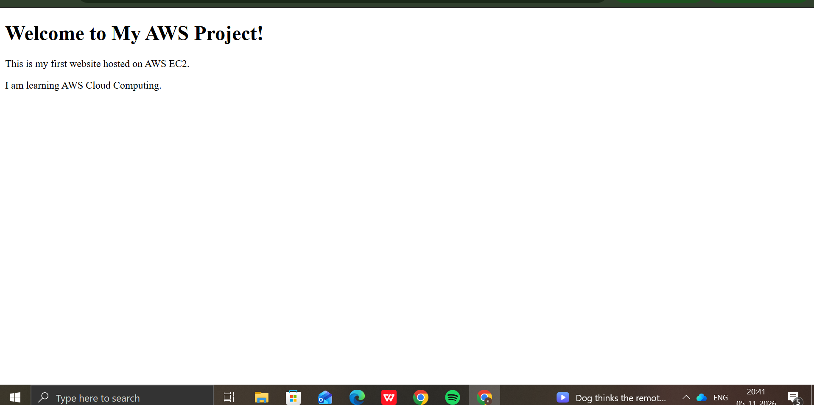

# Static Website Hosting Using AWS EC2 and VPC

## Project Overview
This is my first AWS Cloud project. I created a static website using HTML and successfully hosted it on an Amazon EC2 instance.

## AWS Services Used
- Amazon EC2
- Amazon VPC
- Security Groups

## Technologies Used
- Amazon Linux 2023
- Apache HTTP Server
- HTML
- GitHub
- Linux Commands

## Implementation Steps
1. Created a GitHub repository.
2. Created an HTML website using `index.html`.
3. Launched an EC2 instance using Amazon Linux 2023.
4. Configured Security Group inbound rules for SSH (port 22) and HTTP (port 80).
5. Connected to EC2 using EC2 Instance Connect.
6. Installed and started the Apache web server.
7. Deployed the HTML file from GitHub to the Apache web directory.
8. Tested the website using the EC2 public IP address.

## Project Result
Successfully hosted and accessed my static website through the internet using Amazon EC2 and Apache.

## Skills Learned
- AWS EC2 deployment
- VPC and Security Group configuration
- Linux command line
- Apache web server setup
- Static website hosting
- GitHub basics

## Website Screenshot

## Author
Afsha Tamkinat

